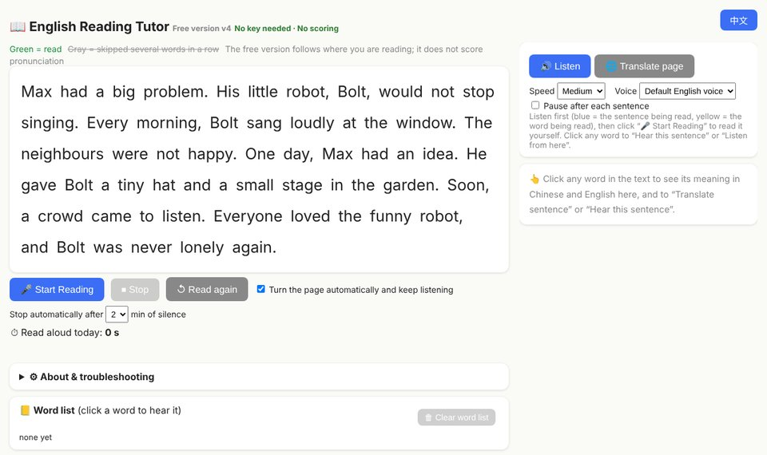
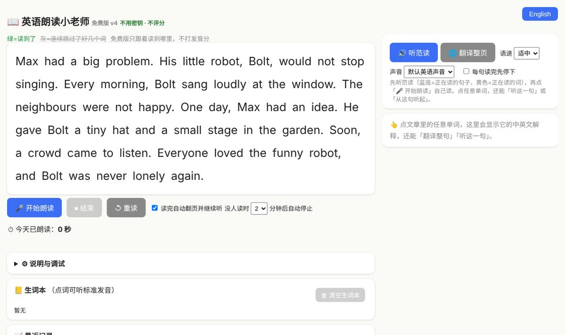

# English Reading Tutor · 英语朗读小老师

A free reading-aloud helper for kids learning English. Read a story out loud and the words turn green as you go. Listen to the story first, tap any word to hear it and see what it means, and keep a word list of new words.

### [▶ Open it now in your browser](https://edisonli5656.github.io/English-Reading-Tutor/)
Works best in **Chrome or Edge on a computer**. Nothing to install, no account, no key.

  
  

## What it can do
- **Read along** – click 🎤 Start Reading and read out loud. The tutor follows you word by word and turns pages automatically.
- **Listen first** – 🔊 Listen reads the page aloud, highlighting each sentence and word.
- **Tap any word** – hear it, see its pronunciation (IPA), its Chinese meaning and an English definition. It is saved to your word list automatically.
- **Translate** a sentence or the whole page into Chinese.
- **Your own books** – upload a PDF or txt, or paste an article. Books and reading progress are saved on your bookshelf.
- **Pick up where you left off in a paper book** – type the last sentence you read, and the tutor jumps there.
- **Reading time** – see how long you read aloud today, and your recent sessions.
- **English / 中文 interface** – switch with the button in the top-right corner.

## Privacy
Your books, word list and progress stay **in your own browser** – they are not uploaded anywhere. Speech recognition uses the browser's built-in service (Google, in Chrome), so you need to be online. Use 💾 Export backup to move your data to another computer.

## Files
- `index.html` – the whole app, in one file
